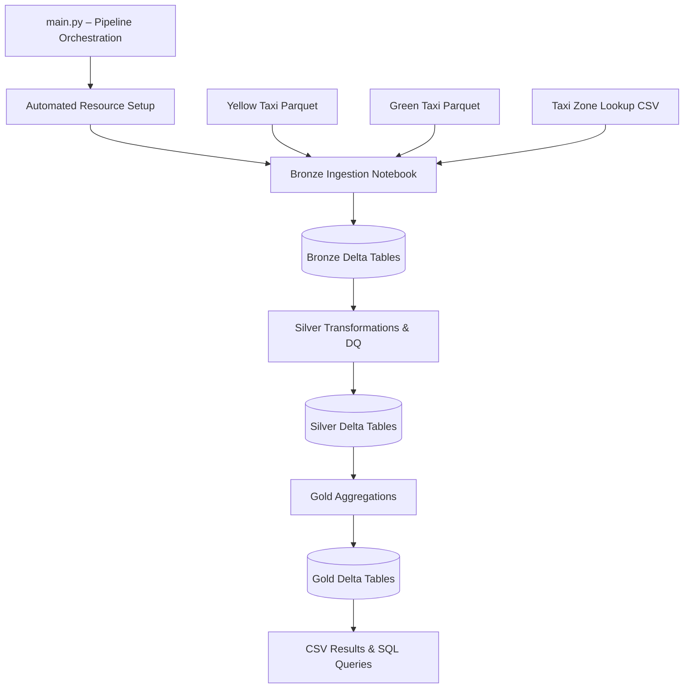

# NYC Taxi Trip Records – Data Engineering Pipeline

## 1. Project Overview

An end-to-end data engineering pipeline built using Databricks, PySpark and Delta Lake to process NYC Yellow and Green Taxi trip records for December 2024, January 2025 and February 2025.

The solution follows the Medallion Architecture (Bronze, Silver and Gold) to ingest source data, standardize different schemas, apply data-quality validations and generate business-ready analytics.

**Business Questions**
1. Daily collected revenue by pickup borough and service type.
2. Airport trip volume, average fare and tipping behaviour for trips to and from JFK, LaGuardia and Newark.
3. Comparison of inbound Manhattan CBD taxi trips before and after congestion pricing implementation on January 5, 2025.

**Technology:** Databricks, PySpark, Spark SQL, Delta Lake, Unity Catalog, Python and YAML.

## 2. Architecture and Layer Design



### Bronze – Raw Ingestion
- Downloads the required monthly Yellow and Green Parquet files and Taxi Zone Lookup CSV through the Bronze notebook.
- Adds ingestion metadata such as source month, source file and ingestion timestamp.
- Stores source datasets as Delta tables.

**Tables:** `yellow_trips`, `green_trips`, `taxi_zone_lookup`

### Silver – Standardization and Data Quality
- Maps Yellow TPEP and Green LPEP fields into a common canonical schema.
- Standardizes column names and data types and combines records using `unionByName`.
- Enriches trip data using the Taxi Zone Lookup dimension.
- Applies data-quality validations, retaining valid records and isolating invalid records in quarantine.

**Tables:** `unified_trips`, `dim_taxi_zones`, `quarantined_trips`

### Gold – Business Analytics
Produces three business-ready Delta tables:

| Table | Purpose |
|---|---|
| `daily_revenue` | Daily collected revenue by pickup borough and service type |
| `airport_analysis` | Monthly airport volume, average fare and tipping metrics by service type and direction |
| `congestion_pricing_impact` | Before-and-after comparison of inbound Manhattan CBD trips |

## 3. Project Structure

```text
Take-Two-Data-Engineering-Assessment/
├── README.md
└── take_two_nyc_taxi/
    ├── config/
    │   ├── config.yaml
    │   └── config_loader.py
    ├── setup/
    │   ├── create_resources.sql
    │   └── create_folders.py
    ├── src/
    │   ├── bronze/
    │   │   ├── ingestion.py
    │   │   └── download_source_files.py
    │   ├── silver/
    │   │   ├── transformations.py
    │   │   └── data_quality.py
    │   └── gold/
    │       └── aggregations.py
    ├── notebooks/
    │   ├── bronze_ingestion
    │   ├── silver_transformations
    │   └── gold_analytics
    ├── output/
    │   ├── results/
    │   ├── sql_queries/
    │   └── screenshots/
    ├── main.py
    ├── DQ_SPEC.md
    ├── DATA_DICTIONARY.md
    ├── AI_DISCLOSURE.md
    ├── architecture.mmd
    ├── requirements.txt
    └── .gitignore
```

## 4. Setup and Execution

**Prerequisites**
- Databricks workspace with Unity Catalog enabled.
- Permissions to create schemas and Volumes.
- Access to the project repository.

**Execution**

Run `main.py` from the Databricks workspace:

```bash
python main.py
```

The entry point automates the following steps:

1. Creates the required Databricks schemas and source-data Volume.
2. Creates the Yellow and Green source folders.
3. Runs Bronze ingestion, including downloading the required source files.
4. Runs Silver transformations and data-quality validations.
5. Runs Gold aggregations.

Stages execute sequentially. If a stage fails, subsequent dependent stages are skipped and the error is logged.

## 5. Data Quality and Schema Reconciliation

Data-quality rules are documented in `DQ_SPEC.md` and implemented in the Silver layer.

Key issues and handling:
- Missing pickup/drop-off timestamps: quarantine.
- Drop-off earlier than pickup: quarantine.
- Missing pickup/drop-off location IDs: quarantine.
- Missing total amount: quarantine.
- Invalid source month or timestamps outside the expected source period: quarantine.
- Negative fare/total amounts and unusual congestion-fee values: retained with warning flags for investigation.

Yellow and Green datasets represent the same business event but have different source schemas. Equivalent TPEP and LPEP fields are mapped to canonical column names and consistent data types. Fields unavailable in one source are represented as nullable columns, and both datasets are combined using `unionByName`, preserving the service type.

**Processing results:** 10,870,081 Bronze trip records; 10,869,523 valid Silver records; 558 quarantined records.

## 6. Business Logic and Assumptions

- Trip timestamps are treated as local New York timestamps.
- Collected revenue uses `total_amount` and includes only the configured successful payment types.
- Airport direction is identified using pickup and drop-off airport zones.
- Tipping analysis uses credit-card transactions because cash tips are not consistently captured.
- January 5, 2025 is treated as the congestion pricing effective date.
- Drop-off timestamp is used as a proxy for the time a trip enters the Manhattan CBD.
- Congestion pricing results are descriptive comparisons, not proof of causation.

Detailed Gold column definitions, data types, grain and lineage are documented in `DATA_DICTIONARY.md`.

## 7. Operations, Scaling and Limitations

- **Logging and monitoring:** Pipeline stage start, completion and failure are logged. In production, I would alert on failed runs, abnormal source counts, quarantine spikes and missed completion SLAs.
- **Deployment and rollback:** Changes would be version-controlled in Git and promoted through development and production environments. Failed deployments can be rolled back to a previous code version, with Delta table history used for data recovery where retention permits.
- **Idempotency:** The current pipeline uses overwrite-based Delta writes for full refreshes, making reruns on the same inputs repeatable.
- **100× scale:** Introduce incremental ingestion and watermarks, optimize partitioning and file sizes, use Delta OPTIMIZE and suitable clustering, tune Spark shuffles, and implement incremental Gold aggregations.
- **Deliberate omissions:** Production scheduling, automated alert notifications, incremental processing and causal/statistical evaluation of congestion pricing impact are outside the current implementation scope.

## 8. Supporting Deliverables

- [Data Quality Specification](take_two_nyc_taxi/DQ_SPEC.md)
- [Gold Data Dictionary](take_two_nyc_taxi/DATA_DICTIONARY.md)
- [Architecture Diagram](take_two_nyc_taxi/architecture.mmd)
- [AI Usage Disclosure](take_two_nyc_taxi/AI_DISCLOSURE.md)

**Saved Gold results**
- [Daily Revenue CSV](take_two_nyc_taxi/output/results/daily_revenue/daily_revenue.csv)
- [Airport Analysis CSV](take_two_nyc_taxi/output/results/airport_analysis/airport_analysis.csv)
- [Congestion Pricing CSV](take_two_nyc_taxi/output/results/congestion_pricing/congestion_pricing_impact.csv)

Executed SQL queries and screenshots are available in `take_two_nyc_taxi/output/sql_queries/` and `take_two_nyc_taxi/output/screenshots/`, respectively.
