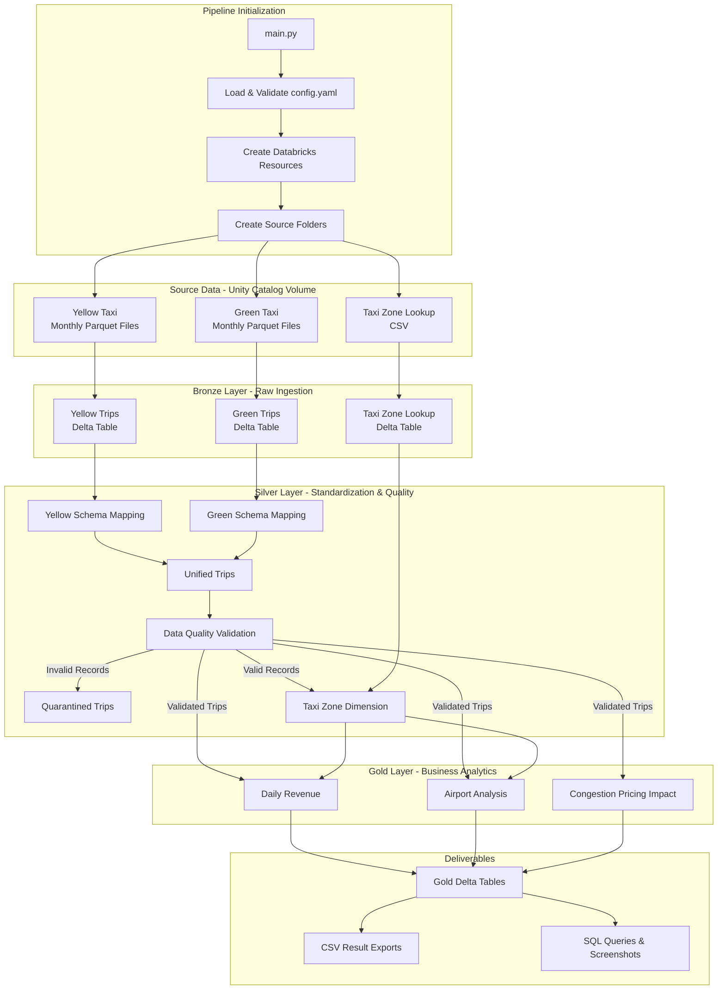

# NYC Taxi Trip Records – End-to-End Data Engineering Pipeline

**Take-Two Interactive | Senior Data Engineer – Technical Assessment**

An end-to-end data engineering solution built using **Databricks, PySpark, Apache Spark and Delta Lake** to process NYC Yellow and Green Taxi trip records for December 2024, January 2025 and February 2025.

The pipeline follows the **Medallion Architecture (Bronze, Silver and Gold)** to ingest raw data, standardize source schemas, enforce data quality and generate analytics-ready datasets for business reporting.

---

## 1. Project Overview

The objective is to build a scalable and maintainable data pipeline that processes NYC taxi trip records and answers three business questions:

1. How does daily taxi revenue vary by pickup borough and service type?
2. What are the monthly airport trip volumes, average fares and tipping behaviours for JFK, LaGuardia and Newark?
3. How did inbound Manhattan CBD taxi trip metrics change before and after congestion pricing implementation in January 2025?

### Technology Stack

| Component | Technology |
|---|---|
| Data Platform | Databricks |
| Processing Engine | Apache Spark / PySpark |
| Storage Format | Delta Lake |
| Data Governance | Unity Catalog |
| Programming | Python and SQL |
| Configuration | YAML |
| Architecture | Medallion Architecture |
| Version Control | GitHub |

---

## 2. Architecture

The pipeline uses a sequential orchestration model. The main entry point handles configuration validation, resource creation, source folder creation and execution of the Bronze, Silver and Gold stages.



For the complete architecture diagram, see [`architecture.mmd`](take_two_nyc_taxi/architecture.mmd).

---

## 3. Project Structure

```text
Take-Two-Data-Engineering-Assessment/
│
├── README.md
│
└── take_two_nyc_taxi/
    │
    ├── config/
    │   ├── config.yaml
    │   └── config_loader.py
    │
    ├── setup/
    │   ├── create_resources.sql
    │   └── create_folders.py
    │
    ├── src/
    │   ├── bronze/
    │   │   ├── ingestion.py
    │   │   └── download_source_files.py
    │   │
    │   ├── silver/
    │   │   ├── transformations.py
    │   │   └── data_quality.py
    │   │
    │   └── gold/
    │       └── aggregations.py
    │
    ├── notebooks/
    │   ├── bronze_ingestion
    │   ├── silver_transformations
    │   └── gold_analytics
    │
    ├── output/
    │   ├── screenshots/
    │   ├── sql_queries/
    │   │   ├── daily_revenue.sql
    │   │   ├── airport_analysis.sql
    │   │   └── congestion_pricing_impact.sql
    │   │
    │   └── results/
    │       ├── daily_revenue/
    │       │   └── daily_revenue.csv
    │       ├── airport_analysis/
    │       │   └── airport_analysis.csv
    │       └── congestion_pricing/
    │           └── congestion_pricing_impact.csv
    │
    ├── README.md
    ├── DQ_SPEC.md
    ├── DATA_DICTIONARY.md
    ├── AI_DISCLOSURE.md
    ├── architecture.mmd
    ├── main.py
    ├── requirements.txt
    └── .gitignore
```

---

## 4. Data Pipeline Design

### Bronze Layer – Raw Ingestion

The Bronze layer ingests the monthly Yellow and Green Taxi Parquet files and Taxi Zone Lookup CSV.

Key responsibilities:

- Reads source files from Unity Catalog Volume.
- Maintains separate Bronze tables for Yellow and Green trips.
- Ingests Taxi Zone Lookup data.
- Adds ingestion metadata:
  - `source_month`
  - `source_file`
  - `ingestion_timestamp`
- Stores ingested datasets in Delta format.

**Bronze tables:**

- `workspace.nyc_taxi_bronze.yellow_trips`
- `workspace.nyc_taxi_bronze.green_trips`
- `workspace.nyc_taxi_bronze.taxi_zone_lookup`

### Silver Layer – Standardization and Data Quality

The Silver layer creates a unified analytical structure across Yellow and Green Taxi records.

Key responsibilities:

- Maps source-specific columns into a common canonical schema.
- Handles differences in column names, data types and available fields.
- Standardizes timestamps and numeric fields.
- Combines records using `unionByName`.
- Builds the Taxi Zone dimension.
- Applies data quality checks.
- Separates invalid records into a quarantine table.

**Silver tables:**

- `workspace.nyc_taxi_silver.unified_trips`
- `workspace.nyc_taxi_silver.dim_taxi_zones`
- `workspace.nyc_taxi_silver.quarantined_trips`

### Gold Layer – Business Analytics

The Gold layer generates three analytical datasets.

**1. Daily Revenue Analysis**

Grain: Pickup date + pickup borough + service type.

Metrics include:

- Total trip count
- Collected trip count
- Collected revenue
- Excluded payment trip count

**2. Airport Trip Analysis**

Grain: Month + airport + service type + direction.

Airports:

- JFK
- LaGuardia
- Newark

Metrics include:

- Trip volume
- Average fare
- Credit-card trip count
- Observed card tip count
- Tipped card trip count
- Average card tip
- Average positive card tip
- Card tip rate percentage

**3. Congestion Pricing Impact**

Compares inbound Manhattan CBD trips before and after January 5, 2025.

Metrics include:

- Total trip count
- Paid trip count
- Collected revenue
- Average fare
- Total CBD congestion fee
- Trips with CBD fee
- Average trips per day
- Average revenue per day

**Gold tables:**

- `workspace.nyc_taxi_gold.daily_revenue`
- `workspace.nyc_taxi_gold.airport_analysis`
- `workspace.nyc_taxi_gold.congestion_pricing_impact`

---

## 5. Configuration and Prerequisites

Project settings are maintained in:

`take_two_nyc_taxi/config/config.yaml`

Configuration includes:

- Unity Catalog name
- Project schema and Volume
- Source folder names
- Processing months
- Bronze, Silver and Gold schemas
- Delta table names
- Reporting date range

### Prerequisites

- Databricks workspace with Unity Catalog access.
- Permissions to create schemas, tables and Volumes.
- GitHub repository connected through Databricks Git Folders.
- Required Yellow and Green Taxi Parquet files.
- Taxi Zone Lookup CSV.
- PyYAML dependency.

Databricks provides Spark and Delta Lake through its runtime. If PyYAML is unavailable, install it using:

```python
%pip install PyYAML
```

---

## 6. Setup and Execution

The pipeline is designed around a single execution entry point: `main.py`.

### Step 1: Import the repository

1. Open Databricks.
2. Navigate to Git Folders.
3. Select Add Git Folder.
4. Provide the GitHub repository URL.
5. Select the required branch.
6. Open the `take_two_nyc_taxi` project folder.

### Step 2: Configure the environment

Review:

`take_two_nyc_taxi/config/config.yaml`

Ensure that the catalog, schemas, Volume, source folders and reporting dates match the target environment.

### Step 3: Prepare source data

Upload the monthly source files into the Unity Catalog Volume.

Expected location:

```text
/Volumes/workspace/nyc_taxi/source_data/
│
├── Yellow/
│   ├── yellow_tripdata_2024-12.parquet
│   ├── yellow_tripdata_2025-01.parquet
│   └── yellow_tripdata_2025-02.parquet
│
├── green/
│   ├── green_tripdata_2024-12.parquet
│   ├── green_tripdata_2025-01.parquet
│   └── green_tripdata_2025-02.parquet
│
└── taxi_zone_lookup.csv
```

### Step 4: Execute the pipeline

Execute `main.py` from the Databricks environment.

The orchestrator performs the following operations:

1. Loads and validates configuration.
2. Creates Databricks schemas and source Volume.
3. Creates the Yellow and Green source folders.
4. Executes Bronze ingestion.
5. Executes Silver transformation after Bronze succeeds.
6. Executes Gold analytics after Silver succeeds.

Execution flow:

```text
main.py
   |
   v
Configuration Validation
   |
   v
Resource Creation
   |
   v
Source Folder Creation
   |
   v
Bronze Ingestion
   |
   v
Silver Transformation
   |
   v
Gold Analytics
   |
   v
Pipeline Completed
```

Each notebook returns a success status to the orchestrator. If a stage fails, the pipeline stops and subsequent dependent stages are not executed.

Individual notebooks can also be run independently for development and troubleshooting.

---

## 7. Data Quality and Processing Results

Data quality checks are applied in the Silver layer before publishing validated records.

The implementation includes checks for:

- Missing pickup and drop-off timestamps.
- Drop-off timestamp earlier than pickup timestamp.
- Missing pickup and drop-off location identifiers.
- Missing total amount.
- Invalid source month.
- Timestamp outside the expected source period.
- Warning-level conditions such as negative amounts and unexpected congestion fee values.

Invalid records are separated into the quarantine Delta table. Warning-level records are retained with appropriate quality flags.

### Observed Processing Results

| Dataset | Records |
|---|---:|
| Yellow Bronze | 10,721,140 |
| Green Bronze | 148,941 |
| Combined Bronze | 10,870,081 |
| Silver Validated | 10,869,523 |
| Silver Quarantined | 558 |
| Taxi Zone Lookup | 265 |

Detailed validation rules, severity levels and failure actions are documented in:

[`DQ_SPEC.md`](take_two_nyc_taxi/DQ_SPEC.md)

---

## 8. Gold Results and Deliverables

The three Gold datasets are exported as CSV files for assessment review.

| Business Question | Exported File | Records |
|---|---|---:|
| Daily Revenue | `daily_revenue.csv` | 1,230 |
| Airport Analysis | `airport_analysis.csv` | 34 |
| Congestion Pricing Impact | `congestion_pricing_impact.csv` | Refer to CSV |

### Result Locations

- [Daily Revenue CSV](take_two_nyc_taxi/output/results/daily_revenue/daily_revenue.csv)
- [Airport Analysis CSV](take_two_nyc_taxi/output/results/airport_analysis/airport_analysis.csv)
- [Congestion Pricing CSV](take_two_nyc_taxi/output/results/congestion_pricing/congestion_pricing_impact.csv)

### SQL Queries

Reusable queries for the three business questions are included under:

`take_two_nyc_taxi/output/sql_queries/`

- [Daily Revenue SQL](take_two_nyc_taxi/output/sql_queries/daily_revenue.sql)
- [Airport Analysis SQL](take_two_nyc_taxi/output/sql_queries/airport_analysis.sql)
- [Congestion Pricing SQL](take_two_nyc_taxi/output/sql_queries/congestion_pricing_impact.sql)

Execution and validation evidence is maintained in:

`take_two_nyc_taxi/output/screenshots/`

---

## 9. Business Logic and Assumptions

- Revenue is calculated using the trip `total_amount` field.
- Collected revenue includes payment types 0, 1 and 2 when the total amount is available.
- Daily revenue is grouped by pickup date, pickup borough and service type.
- Airport zones are identified using Taxi Zone Lookup information.
- Airport direction is determined by whether the pickup or drop-off location is an airport.
- Credit-card payment type is identified as payment type 1.
- Tipping analysis distinguishes observed card tips from positive card tips.
- Inbound CBD trips are identified using configured taxi zone IDs, with pickup outside and drop-off inside the defined CBD zones.
- January 5, 2025 is treated as the congestion pricing effective date.
- Drop-off timestamp is used as a proxy for CBD entry time.
- The congestion pricing comparison is descriptive and should not be interpreted as a causal impact evaluation.
- Yellow and Green records are standardized into a common schema; unavailable source fields are represented as nullable fields.

Detailed Gold metric definitions are available in:

[`DATA_DICTIONARY.md`](take_two_nyc_taxi/DATA_DICTIONARY.md)

---

## 10. Operational Considerations

### Logging and Monitoring

- Pipeline stages use Python logging.
- Notebook execution status and Spark errors are available through Databricks.
- Pipeline runs can be monitored through the Databricks execution interface.
- Data quality outcomes are monitored through valid and quarantined record counts.

### Idempotency

The current implementation uses overwrite-based Delta writes for full pipeline refreshes.

Re-running the pipeline with the same source data and configuration is intended to reproduce the target datasets.

Incremental ingestion, merge-based writes and retry-safe processing are recommended for production workloads.

### Deployment and Rollback

- Source code and configuration are maintained in GitHub.
- Changes should be tested in a development environment before deployment.
- Git commit history supports code version rollback.
- Delta table history and versioning can support data recovery where applicable.

### Scaling to 100x Data Volume

Potential improvements include:

- Incremental ingestion instead of full refreshes.
- Partition pruning and optimized file sizing.
- Delta Lake OPTIMIZE and appropriate clustering strategies.
- Spark shuffle and executor resource tuning.
- Parallel processing of independent source datasets.
- Incremental Gold aggregations.
- Centralized data quality monitoring and automated alerts.

---

## 11. Scope and Limitations

- The current implementation processes three monthly data periods.
- Pipeline writes use full-refresh overwrite behaviour.
- Production alerting and automated failure notifications are not implemented.
- Congestion pricing analysis is descriptive rather than causal.
- Large-scale incremental processing and performance tuning are future enhancements.

---

## 12. Supporting Documentation

| Document | Description |
|---|---|
| [DQ Specification](take_two_nyc_taxi/DQ_SPEC.md) | Data quality checks, severity and failure handling |
| [Data Dictionary](take_two_nyc_taxi/DATA_DICTIONARY.md) | Gold table definitions and metric descriptions |
| [AI Disclosure](take_two_nyc_taxi/AI_DISCLOSURE.md) | Disclosure of AI-assisted development |
| [Architecture Diagram](take_two_nyc_taxi/architecture.mmd) | Detailed pipeline architecture |
| [Pipeline Entry Point](take_two_nyc_taxi/main.py) | Main pipeline orchestration |

---

**Project:** NYC Taxi Trip Records Data Engineering Pipeline  
**Platform:** Databricks  
**Architecture:** Medallion (Bronze / Silver / Gold)  
**Processing:** PySpark and Delta Lake
